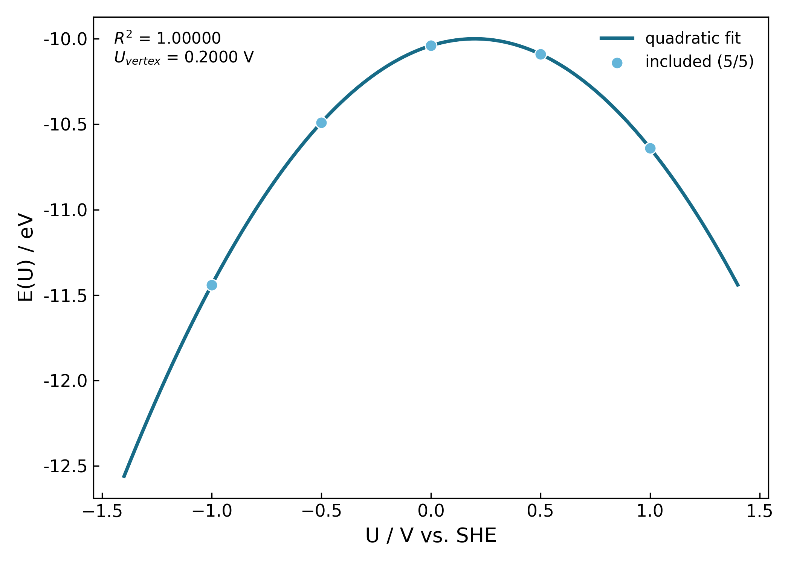

# E-U 结果与示例

先检查数据质量，再看曲线形状。五点的高 R² 不能代替结构、磁态或能量零点的一致性检查。

## 输出文件

| 文件 | 用途 |
| --- | --- |
| `results/summary.csv` | 原始五点汇总，复查电荷、能量、电势和纳入状态 |
| `results/quality_report.csv` | audit 生成的详细质量审计 |
| `results/points_to_rerun.csv` | 建议检查或重算的点 |
| `results/eu/eu_curve.png` | 五点 E-U 拟合图 |
| `results/eu/eu_curve.csv` | 从拟合式生成的曲线数据，不是额外计算点 |
| `results/eu/analysis.json` | 原始点、二次系数、顶点、残差与来源 |
| `results/eu/report.md` | 分析报告 |

`eu/` 内还有仅根据汇总表标志生成的简要质量表，不能替代根目录详细审计。
重新分析会覆盖指定输出目录内的同名文件，需要保留旧结果时换一个输出目录。

## 合成示例：认识一张 E-U 图

下面的数据由解析式 **E(U) = -10 - (U - 0.2)²** 生成，不是 VASP 计算结果，不对应任何真实材料。
它只用于检查后处理和展示输出，不能用于论文结论或物理参数标定。



图由 VASPsolKit 现有 postprocess 生成，包含五个点及唯一的零电子偏移点。
示例故意采用精确二次数据，所以 R² 为 1；真实计算不应以“必须达到同样的 R²”为验收标准。

[下载合成五点 CSV](_static/example-summary.csv)

安装 VASPsolKit 后，将下载的文件放到独立演示目录，运行：

```bash
vaspsolkit postprocess --summary example-summary.csv --output example-eu
```

这个演示只读取 CSV，不运行 VASP、不查询或提交集群任务。CSV 的 converged 标志仅为演示填写，
不代表进行过真实收敛检查。解析式见上文，CSV 保留电荷偏移及 synthetic 方法标识。

## 怎么判断结果是否可用

1. 原始数据确有五点，且唯一中性点参与拟合。
2. 各点电子/离子收敛，输出完整，结构与磁态可比较。
3. 所用 VASPsol 分支、SHE 标定、能量和电势对齐一致。
4. 查看每个点的残差，不仅比较 R²；不通过删中性点追求更漂亮的曲线。
5. 关注实际取样范围；绘图延伸区间不增加物理证据。

二次顶点 U_vertex 不自动等于 PZC，当前电子能量也不是自动修正好的完整 Gibbs 自由能。
内置电势处理不自动识别真空平台，也不应用 FERMI_SHIFT。具体公式与限制见[计算约定](SCIENTIFIC_CONVENTIONS.md)。
